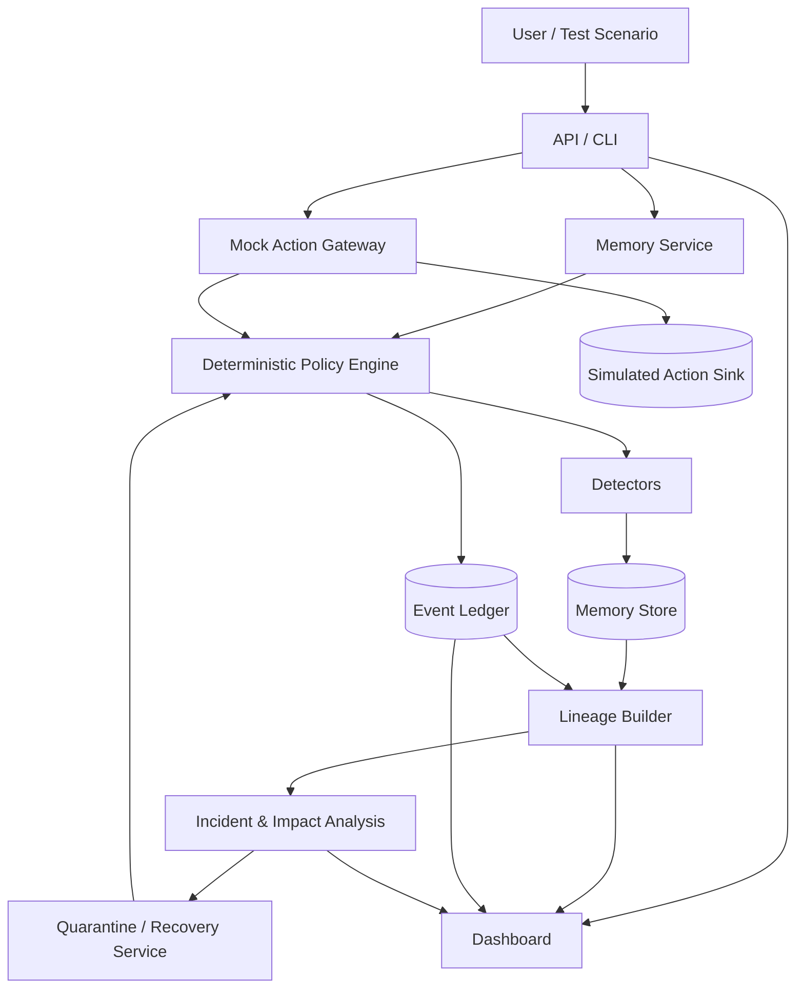

# 5. System Architecture

## Architecture goals

1. Keep policy enforcement independent from model-generated reasoning.
2. Maintain provenance and audit events across sessions.
3. Separate data plane (memory operations) from investigation/control plane (queries, quarantine, restore, reporting).
4. Support deterministic local execution without external model APIs.
5. Make the demo safe and reproducible.

## Logical architecture

## Component responsibilities

- `core/policy.py`: deterministic decision types, rules, and reason codes.
- `core/memory_service.py`: guarded read/write/delete/snapshot/restore orchestration.
- `detectors/`: detector interface and initial deterministic detectors.
- `ledger/event_store.py`: append operation events and read history.
- `lineage/graph.py`: explicit parent/source edges and inferred-edge annotations.
- `containment/quarantine.py`: quarantine state and review workflow.
- `recovery/service.py`: checkpoint validation, restore, safe replay, recovery record.
- `actions/gateway.py`: final authorization check for simulated tool calls.
- `evaluation/scenarios.py`: versioned attack and benign fixtures.
- `evaluation/runner.py`: execute scenarios and compute metrics.
- `api/`: request/response schemas and endpoints.
- `ui/`: timeline, lineage graph, policy explanation and benchmark view.

## Trust boundaries

- User-provided documents and memory values are untrusted input.
- LLM summaries and generated claims are untrusted until validated.
- The policy engine and action gateway are security-critical.
- The event ledger is evidence storage; its contents still need access control and integrity checks.
- The browser/dashboard is a presentation layer and must not make authorization decisions.

## Data flow for a write

1. Receive request with principal, key, value, source reference, and request/run ID.
2. Validate types, size limits, and schema.
3. Resolve principal and policy.
4. Run applicable detectors.
5. Decide `ALLOW`, `DENY`, `REDACT`, or `QUARANTINE` using explicit policy logic.
6. Persist memory state only if allowed; persist redacted/quarantined metadata as configured.
7. Append the decision event. If ledger persistence fails, sensitive write should fail safely or be marked not committed; the chosen transaction strategy must be implemented and tested.
8. Return a structured decision without exposing hidden secrets.

## Data flow for a protected action

Every action request must pass through `actions/gateway.py`. The gateway checks principal, action, data classification, destination, and policy. Only an allowed request reaches the mock sink. The agent must not have a separate direct path to the sink.

## Storage model for MVP

SQLite stores memory metadata, memory values for synthetic tests, event records, graph edges, snapshots, quarantines, and benchmark runs. Use transactions for memory mutation plus event recording where feasible. Define behavior for partial failure in tests. Keep repository interfaces small enough to replace SQLite later.

## Deployment model

Local-only application for the initial demo. Bind to loopback by default. No unauthenticated network exposure. If a remote deployment is added, authentication, authorization, secret management, TLS, rate limits, and a deployment threat review are required first.
